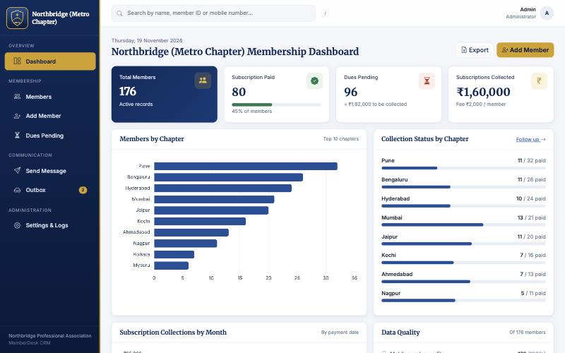

# MemberDesk CRM

A small, self-hosted CRM for membership associations. Track members and subscription payments, see who still owes dues, and send reminders by email or WhatsApp. Every outgoing message waits in an approval Outbox until someone signs it off.

Built with **Flask** and **SQLite**. It runs on your own computer, with no cloud service and no build step.

> The repository ships with **fictional demo data** for an invented organisation, *Northbridge Professional Association*. All names, phone numbers (90000xxxxx) and emails (@example.com) are made up.



## Demo video

▶️ **[Watch the 6-minute walkthrough on YouTube](https://youtu.be/sW_6nSUBdRM)**: sign-in, the dashboard, member profiles, editing and adding members, and the dues-pending list.

The video was recorded on the original in-house version of the app. This repository is the same app with its branding removed and SQLite in place of Excel.

## Features

| Area | What you get |
|---|---|
| **Dashboard** | Total, paid and pending members, amount collected, members by chapter, collection status per chapter, collections by month, member status and category breakdowns, data-quality meters, recent updates and the activity log |
| **Search** | Live search in the top bar (press `/`) by name, member ID or any 3+ digits of a mobile number |
| **Members** | Filter by payment status, place, chapter, status, category, practicing, gender or missing data. Sort, paginate, and export the current view to Excel |
| **Profiles** | Contact, personal, education, professional registration numbers, organisation, subscription and receipt details, notes, and communication history |
| **ID documents (Aadhaar)** | Upload a PDF, JPG or PNG (5 MB max). The file type is checked by its content, the file is stored under a random name, only signed-in staff can open it, and every view is logged |
| **Messaging** | Templates with placeholders (`{name}`, `{member_id}`, `{fee}` …) for one member, a selection or a whole filtered list. Messages go to an **approval Outbox**, with per-batch and per-day send limits |
| **Settings & logs** | Integration status, safety limits, latest backups, the full audit trail and a database download |

## Quick start

Requires Python 3.9+.

```bash
git clone https://github.com/mdiwakar2026/MemberDesk-CRM.git
cd MemberDesk-CRM
python -m venv .venv
source .venv/bin/activate          # Windows: .venv\Scripts\activate
pip install -r requirements.txt
python setup_admin.py              # choose the admin username and password
python app.py                      # http://127.0.0.1:5000
```

On first run the app creates `.env` (with a random secret key) and builds `data/memberdesk.db` from `db/schema.sql` and `db/seed.sql`.

Windows users can double-click `install.bat` once and then `run_crm.bat`.

## Database

| File | Purpose |
|---|---|
| `db/schema.sql` | Tables `members`, `communications` and `audit_log`, plus the view `member_payment_status` |
| `db/seed.sql` | 180 demo members across 10 chapters and a few sample messages |
| `scripts/generate_seed.py` | Regenerates `seed.sql`, e.g. `python scripts/generate_seed.py 500` |
| `data/memberdesk.db` | The live database (git-ignored). Delete it to start again from the seed |

Each change and its audit-log entry are written in a single transaction. A backup copy of the database is saved to `data/backups/` every time the app starts (the newest 50 are kept).

You can query the database directly, for example:

```bash
sqlite3 data/memberdesk.db "SELECT chapter, COUNT(*) FROM member_payment_status WHERE payment_status='Not Paid' GROUP BY chapter;"
```

## Configuration (`.env`)

| Setting | Meaning |
|---|---|
| `ADMIN_USERNAME`, `ADMIN_PASSWORD` | Sign-in for the single admin account (`python setup_admin.py` sets them) |
| `ORG_NAME`, `ORG_SHORT` | Your organisation's name, shown throughout the app and in message templates |
| `SUBSCRIPTION_FEE` | Annual fee; members with any amount paid count as **Paid** |
| `SMTP_*` | Turns on automatic email sending (Gmail: `smtp.gmail.com`, port 587, App Password) |
| `WHATSAPP_TOKEN`, `WHATSAPP_PHONE_NUMBER_ID` | Turns on WhatsApp Cloud API sending |
| `MAX_SEND_PER_BATCH`, `MAX_SEND_PER_DAY` | Caps on outgoing messages (25 per batch and 200 per day by default) |

Without SMTP or WhatsApp credentials, the Outbox gives you click-to-chat (`wa.me`) and `mailto:` links instead. You send each message yourself and then press **Mark as sent**.

To use your own logo, replace `static/img/logo.svg`.

## Safety design

* **Human in the loop:** composing a message only queues it. Nothing is sent until an admin ticks the confirmation box and approves it in the Outbox.
* **No secrets in code:** the password and API keys are read from `.env` only, and `.env` is git-ignored.
* **Send budgets:** sending is capped per batch and per day.
* **Soft delete:** members are archived, never deleted.
* **Protected forms:** every form carries a CSRF token, and session cookies are HTTP-only.

## Project layout

```
app.py               Flask routes
config.py            settings loaded from .env
crm/sql_store.py     SQLite data access
crm/messaging.py     email / WhatsApp delivery and message templates
db/                  schema.sql and seed.sql
templates/, static/  Bootstrap 5 UI
scripts/             demo-data generator
```
